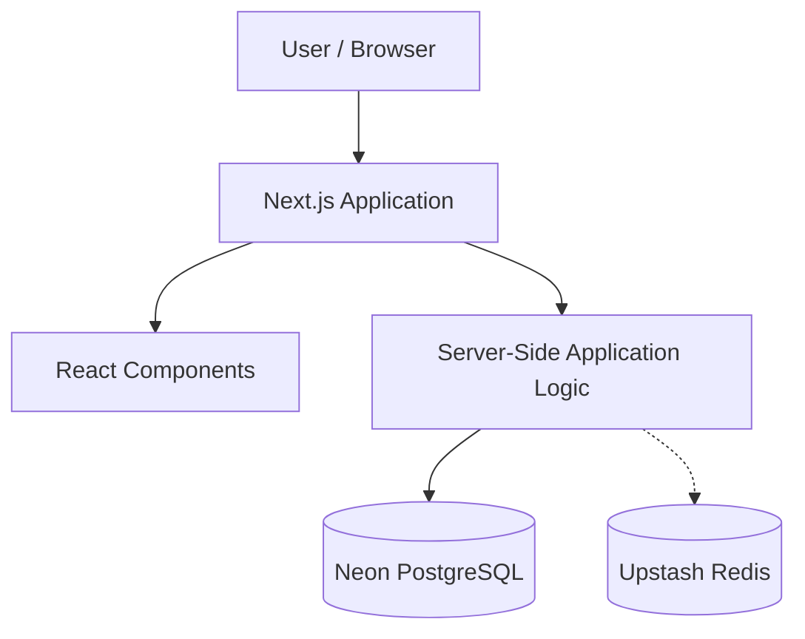

# 🍳 Community Cookbook

### A Cookbook by the Community, for the Community

A full-stack recipe-sharing application built with **Next.js, TypeScript, PostgreSQL, and Redis**, exploring how modern web applications can combine persistent relational storage with a fast, serverless data layer.

Community Cookbook is designed around a simple idea: recipes are better when shared. The project provides a foundation for a community-driven cooking platform while exploring practical full-stack engineering decisions, from database selection to state management and scalability.

## 🛠 Tech Stack

| Technology | Purpose |
|---|---|
| Next.js 16 | Full-stack application framework |
| React 19 | Component-based user interface |
| TypeScript | Type safety and maintainability |
| PostgreSQL (Neon) | Persistent relational database |
| Redis (Upstash) | Fast key-value storage |
| Tailwind CSS 4 | Responsive UI styling |
| ESLint | Code quality and consistency |

## 🎯 Problem Statement

Recipes are often scattered across websites, personal notes, social media, and cooking communities, making them difficult to organize, discover, and share.

Community Cookbook aims to provide a centralized platform where community-contributed recipes can be collected and explored.

From an engineering perspective, the challenge is to build a maintainable application that can support structured recipe data while accommodating frequently accessed or temporary application state.

The project explores three fundamental concerns:

- **Data persistence:** Maintaining reliable, structured recipe information.
- **Performance:** Avoiding unnecessary work when accessing frequently requested data.
- **Scalability:** Designing an architecture that can evolve as the number of recipes and users increases.

## ✨ Project Goals

- Build a community-oriented recipe-sharing experience.
- Maintain a modular, type-safe application architecture.
- Use a relational database for durable application data.
- Explore Redis as a complementary fast-access data store.
- Keep frontend and backend development within a unified framework.
- Establish a foundation for future performance and scalability improvements.

## 🏗️ System Architecture

The application follows a full-stack Next.js architecture, with application logic and data access organized alongside the frontend.

### High-Level Architecture



**Component responsibilities:**

| Layer | Responsibility |
|---|---|
| Presentation | Rendering the user interface using React and Tailwind CSS |
| Application | Handling routing, server-side operations, and application logic through Next.js |
| Persistence | Storing structured, durable information in PostgreSQL |
| Fast-access storage | Supporting suitable key-value operations through Redis |
| Type definitions | Maintaining consistent application data structures through TypeScript |

The repository separates application routes, reusable components, shared utilities, models, types, and state-related code into dedicated directories.

This structure helps keep the project understandable as additional functionality is introduced.

> **Architecture note:** PostgreSQL and Redis are confirmed project dependencies. The diagram illustrates their intended architectural roles; the exact Redis read/write paths and caching strategy should be verified against the implementation.

## 🗄️ Why PostgreSQL?

PostgreSQL is a natural choice for recipe-oriented applications because recipe information is structured and often relational.

A growing recipe platform may need to represent relationships between recipes, ingredients, categories, authors, and user interactions.

A relational database offers several advantages:

- **Data integrity:** Constraints and relationships help maintain consistent records.
- **ACID transactions:** Related database changes can be handled reliably.
- **Flexible querying:** SQL supports filtering, joins, sorting, and aggregation.
- **Indexing:** Frequently used query patterns can be optimized.
- **Extensibility:** The data model can evolve as the application grows.

### Why Neon?

Neon provides serverless PostgreSQL infrastructure, reducing the operational work required to provision and manage a traditional database server.

Its serverless JavaScript driver also fits naturally into a modern Next.js application.

### Trade-offs

PostgreSQL provides reliability and powerful querying, but it introduces schema-management responsibilities and can become a bottleneck if queries are poorly indexed or database connections are not managed appropriately.

For a recipe-sharing application, the benefits of relational consistency generally outweigh these costs.

## ⚡ Why Redis?

PostgreSQL and Redis solve different problems.

PostgreSQL is appropriate for information that must remain durable and consistent. Redis is useful for information that benefits from fast key-based access or has a temporary lifecycle.

The project includes Upstash Redis, a serverless Redis service with an HTTP-based client.

### Potential Redis Use Cases

| Use Case | Benefit |
|---|---|
| Recipe caching | Reduce repeated database reads |
| Rate limiting | Control excessive requests |
| Temporary state | Store short-lived application data |
| Popular recipe counters | Handle frequently changing counters |
| Cached discovery results | Reduce repeated computation |

These are architectural use cases, not a claim that every feature is implemented in the current repository.

### Why Not Store Everything in Redis?

Redis is not a replacement for PostgreSQL in this architecture.

Using PostgreSQL for durable relational records and Redis for appropriate fast-access operations provides a useful separation of responsibilities.

The main trade-off is additional infrastructure complexity, including cache expiration, invalidation, and consistency between data stores.

## 🔄 State Management

A full-stack application typically manages several different forms of state.

### 1. Persistent State

Durable application data belongs in PostgreSQL.

This may include recipes, their associated metadata, and other structured records as the application evolves.

### 2. Temporary or Shared State

Redis can support state that is short-lived, frequently accessed, or shared across application instances.

Examples include cached results, counters, and temporary request-related information.

### 3. Client-Side State

React manages UI-level state such as user interactions and component rendering.

The repository also contains a dedicated `store/` directory, indicating an organizational boundary for state-related code.

The precise client-state implementation and whether Redis currently stores session, cache, or other application state require source-level verification.

### Design Principle

State should be stored according to its lifetime and consistency requirements rather than placing every kind of state into a single storage system.

## ⚖️ Engineering Trade-offs

| Decision | Benefit | Trade-off |
|---|---|---|
| Next.js full-stack architecture | Unified frontend and backend development | Tighter coupling to framework conventions |
| PostgreSQL | Reliable relational storage | Schema and query management |
| Neon serverless database | Reduced database infrastructure overhead | Network latency and provider dependency |
| Upstash Redis | Convenient fast-access data layer | Additional cost and consistency considerations |
| TypeScript | Compile-time type checking | Additional type-maintenance overhead |
| Modular project structure | Clearer separation of responsibilities | More abstraction as the codebase grows |

The architecture prioritizes a manageable development experience without requiring a separate backend service from the beginning.

## 🧩 Technical Challenges

Several engineering challenges are particularly relevant to this stack.

### 1. Coordinating Multiple Data Stores

Using PostgreSQL and Redis introduces decisions about which system owns each piece of information.

A reliable design must establish PostgreSQL as the source of truth for persistent records and define how temporary Redis data is created, expired, or invalidated.

### 2. Serverless Data Access

Serverless infrastructure changes how applications interact with databases.

Connection management, request latency, and service availability become important considerations.

### 3. Consistent Application State

UI state, server-side data, and persistent database records can change independently.

Avoiding stale information and unnecessary updates requires clearly defined state boundaries.

### 4. Maintaining Type Safety

TypeScript helps keep application contracts consistent, but database results and external inputs still require appropriate runtime validation.

These are the main technical challenge areas associated with the architecture, rather than independently verified accounts of implementation difficulties encountered during development.

## 🚀 Performance Considerations

The project uses technologies that support several performance-oriented design strategies.

### Database Access

PostgreSQL can optimize structured queries through appropriate indexes and selective data retrieval.

### Caching

Redis can reduce repeated database operations when suitable caching and invalidation strategies are implemented.

### Rendering

Next.js provides server-side rendering and related rendering strategies that can reduce the amount of work required in the browser.

### Frontend Efficiency

React's component model and Tailwind CSS provide a foundation for reusable interfaces and maintainable styling.

**Performance note:** These are supported optimization opportunities. Specific cache hit rates, query improvements, response-time reductions, or load-test results have not been established.

## 📈 Scaling to 100,000 Users

At approximately 100,000 registered users, the most important architectural decisions would depend on actual concurrent traffic, read/write patterns, and database load.

Rather than immediately introducing microservices, the preferred approach would be to identify bottlenecks and scale incrementally.

### 1. Optimize Database Queries

- Analyze slow queries using `EXPLAIN ANALYZE`.
- Add indexes for frequently filtered or sorted fields.
- Implement pagination for large recipe collections.
- Monitor database connection utilization.
- Evaluate read replicas when read traffic justifies them.

### 2. Introduce a Deliberate Caching Strategy

- Cache frequently requested public recipe data.
- Define TTLs according to data freshness requirements.
- Invalidate affected cache entries after database writes.
- Track cache hit rates and stale-data incidents.

### 3. Scale Application Instances

Keep request handlers as stateless as practical so multiple application instances can serve traffic without relying on local process memory.

### 4. Move Expensive Operations to Background Jobs

Tasks such as image processing, notifications, and bulk data operations can be moved to asynchronous workers when necessary.

### 5. Optimize Media Delivery

If the application supports user-uploaded recipe images, use object storage and a CDN rather than serving large assets directly from application instances.

### 6. Add Observability

Introduce metrics and monitoring for:

- API latency and error rates
- Database query performance
- Redis usage and cache effectiveness
- Request throughput
- Infrastructure costs

### 7. Improve Reliability

Introduce load testing, rate limiting, automated backups, and recovery procedures appropriate to the application's traffic and availability requirements.

**Scaling philosophy:** Optimize measured bottlenecks before increasing architectural complexity.

## 📁 Project Structure

```text
community-cookbook/
├── app/                 # Next.js application routes
├── components/          # Reusable UI components
├── constants/           # Shared constants
├── lib/                 # Shared utilities and integrations
├── mock/                # Mock data and development fixtures
├── models/              # Application data models
├── public/              # Static assets
├── store/               # State-related code
├── types/               # TypeScript definitions
├── package.json         # Dependencies and scripts
├── next.config.ts       # Next.js configuration
├── tsconfig.json        # TypeScript configuration
└── README.md            # Project documentation
```

## 💻 Getting Started

### Prerequisites

- Node.js compatible with Next.js 16
- npm
- PostgreSQL database credentials for Neon
- Redis credentials for Upstash, if required by the relevant application paths

### Installation

Clone the repository:

```bash
git clone https://github.com/RittickDatta/community-cookbook.git
cd community-cookbook
```

Install dependencies:

```bash
npm install
```

### Environment Configuration

Create a `.env.local` file in the project root.

The application may require environment variables for its database and Redis integrations. Common conventions include:

```env
DATABASE_URL=your_neon_postgresql_connection_string

UPSTASH_REDIS_REST_URL=your_upstash_redis_url
UPSTASH_REDIS_REST_TOKEN=your_upstash_redis_token
```

These names are conventional examples; confirm the exact variable names against the integration code before running the application.

Never commit real credentials to version control.

### Run Locally

```bash
npm run dev
```

Open [http://localhost:3000](http://localhost:3000).

### Production Build

```bash
npm run build
npm run start
```

### Linting

```bash
npm run lint
```

## 🔮 Future Improvements

Potential directions for the project include:

- Recipe search with filtering and pagination
- User authentication and authorization
- Recipe ratings, bookmarks, and comments
- Optimized image uploads and delivery
- Cache invalidation and rate limiting
- Automated integration and end-to-end testing
- Application monitoring and performance benchmarks
- Accessibility improvements
- CI/CD automation

These represent possible enhancements rather than confirmed existing features.

## 👨‍💻 Author

**Rittick Datta**

GitHub: [@RittickDatta](https://github.com/RittickDatta)

Project Repository: [Community Cookbook](https://github.com/RittickDatta/community-cookbook)

---

*Community Cookbook — A Cookbook by the Community, for the Community.*
